# SIFT-Guided Optical Flow for Lunar Descent Trajectory Reconstruction

Recovering a lunar lander's **altitude, velocity and metric 3D trajectory from its descent camera
alone**, using classical computer vision written from scratch in NumPy: image gradients,
Shi-Tomasi feature selection, Lucas-Kanade optical flow (one-step and iterative) and SIFT-seeded
tracking for large motion. No OpenCV, no SciPy, no neural networks.

Course project for **ES666 Computer Vision** at IIT Gandhinagar (Prof. S. Raman), Oct to Nov 2026.

<p align="center">
  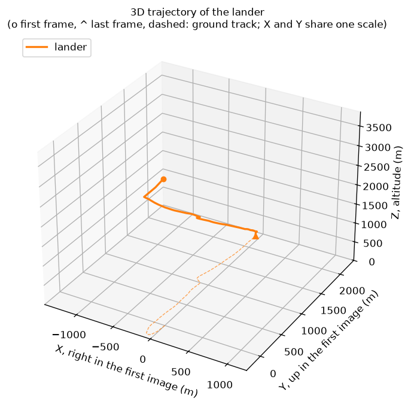
  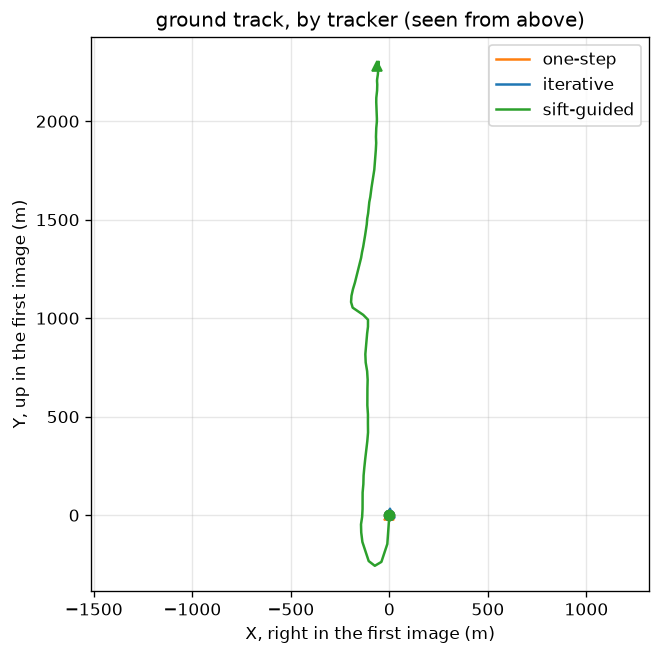
</p>

| At a glance | |
|---|---|
| Input | 144 consecutive nadir images from the Chang'e-5 landing camera (frames 270 to 413, 2352 x 1728 px) |
| Extra information | Focal length (2080 px), frame interval (1 s), one altitude reading (100 m at frame 381) |
| Output | Altitude, 3D position, velocity and time to touchdown for every frame, in metres and seconds |
| Core methods | Central-difference gradients, structure tensor, Shi-Tomasi corners, Lucas-Kanade, iterative KLT, SIFT-guided KLT, robust similarity fit, pinhole geometry |
| Allowed libraries | Python standard library, NumPy, Pillow, Matplotlib |
| Headline result | 168 s descent from 3667 m to 9.1 m, peak descent speed 68.4 m/s, a hover near 100 m, 25 camera timing gaps detected |

---

## Contents

1. [What this project does](#1-what-this-project-does)
2. [What is in the repository](#2-what-is-in-the-repository)
3. [Getting started: clone, install and run](#3-getting-started-clone-install-and-run)
4. [How it works](#4-how-it-works)
5. [Results](#5-results)
6. [Limitations and possible improvements](#6-limitations-and-possible-improvements)
7. [Troubleshooting](#7-troubleshooting)
8. [Credits and references](#8-credits-and-references)

---

## 1. What this project does

### 1.1 The scenario

During the final three minutes of the Chang'e-5 landing (1 December 2020), the lander has pitched
over and its landing camera looks straight down at the lunar surface. Suppose the inertial log for
this phase is lost. The only surviving record is the camera: 144 grayscale images, one per second,
from frame 270 until touchdown at frame 413.

The goal is to answer, **from the images alone**:

- How high was the lander in every frame?
- How fast did it descend, and how fast did it drift sideways?
- Where did it go in 3D, and when did it stop to hover?
- How long until touchdown at each moment?

### 1.2 The key idea

When a camera points straight down at flat ground, the ground features in two consecutive frames
are related by a **similarity transform**: they scale, rotate and translate together.

$$
\mathbf{x}_{k+1} = s_k\,R(\theta_k)\,\mathbf{x}_k + \mathbf{t}_k
$$

- The **zoom** $s_k$ tells how much closer the ground got: $s_k = Z_k / Z_{k+1}$.
- The **rotation** $\theta_k$ tells how much the lander turned about the vertical.
- The **shift** $\mathbf{t}_k$ tells how far it moved sideways (in pixels, convertible to metres
  using altitude and focal length).

So if every feature can be tracked accurately between frames, the whole flight follows. The
project is therefore mostly about **optical flow**: how to measure the motion of image points
accurately, including when that motion is large.

### 1.3 Why it is not trivial

- **Large motion.** Mid-descent, ground features move around 10 px per frame at the working
  resolution, and near touchdown up to 60 px with 25 % zoom. Basic Lucas-Kanade only works for
  about 1 px.
- **Low-contrast terrain.** The lunar surface is grey regolith with craters and rocks; many areas
  have almost no texture.
- **One altitude reading.** Zooms give only altitude ratios. A single anchor converts them to
  metres, so errors in the zooms accumulate.
- **No libraries.** Every vision step is written by hand in NumPy.

### 1.4 The four stages

```text
STAGE 1                     STAGE 2                  STAGE 3                     STAGE 4
Where the image changes  -> One-step flow         -> Large motion             -> Flight reconstruction
  gradients Ix, Iy            Lucas-Kanade as          iterative Lucas-Kanade       similarity fit per frame pair
  temporal change It          least squares            many points at once          zoom -> altitude
  trackable points            single update            SIFT starting guesses        shift -> horizontal motion
  (Shi-Tomasi score)                                                                velocity, 3D path, time to touchdown
  task1.ipynb                 task2.ipynb              task3.ipynb                  task4.ipynb
```

---

## 2. What is in the repository

### 2.1 Layout

```text
.
├── README.md                     this file
├── requirements.txt              Python dependencies
├── pytest.ini                    test configuration
├── run_notebooks.py              runs all notebooks top to bottom in fresh kernels
├── make_submission.py            course helper: builds report.html and a zip
├── tasks.md                      the original task statement
│
├── task1.ipynb                   Stage 1: gradients, temporal difference, feature selection
├── task2.ipynb                   Stage 2: Lucas-Kanade least squares, one-step flow
├── task3.ipynb                   Stage 3: iterative LK, multi-point tracking, SIFT guidance
├── task4.ipynb                   Stage 4: tracker wiring, motion, trajectory, comparison
│
├── assets/                       figures used in this README
│
├── data/
│   ├── README.md                 where the data comes from
│   ├── mission_constants.json    focal length, frame interval, anchor altitude
│   └── frames/                   270.png ... 413.png (NOT in git, see Section 3.4)
│
└── provided/                     course starter code (used by the notebooks)
    ├── io.py                     loading frames, saving tracks
    ├── sampling.py               bilinear_sample, translate
    ├── sift.py                   NumPy SIFT: detection, description, matching, guided tracking
    ├── plotting.py               every figure
    ├── notebook.py               loads functions from saved notebooks, check() cells
    ├── runner.py                 paths and output helpers
    ├── report.py                 report builder for make_submission.py
    ├── test_*.py, conftest.py    shared tests
    ├── task1/ task2/ task3/      steps the notebooks run, and their tests
    └── task4/
        ├── motion_model.py       robust similarity fit
        ├── trajectory.py         zoom, rotation and shift -> altitude, position, velocity
        ├── run.py                full pipeline (also usable from the command line)
        ├── compare_trackers.py   runs the pipeline once per tracker
        ├── animate_trajectory.py interactive 3D animation (Plotly)
        └── test_task4.py
```

### 2.2 What I wrote and what was provided

| Part | Author |
|------|--------|
| All code in the `# YOUR CODE` cells of the four notebooks: gradients, temporal difference, structure tensor, feature score, fast feature selection, Lucas-Kanade update, one-step flow, iterative tracker, multi-point tracker, tracker adapters and `track_pair` | Me |
| All written analysis in the notebooks | Me |
| Everything in `provided/` (I/O, bilinear sampling, SIFT, similarity fit, flight code, plots, tests) | Course staff (starter code) |

The notebooks only contain the implementations and the analysis. Later notebooks import the
functions of earlier ones directly from the **saved** `.ipynb` files (`use_my_functions` in
`provided/notebook.py`), so the notebooks must be saved and run in order.

### 2.3 Mission constants

`data/mission_constants.json`:

| Key | Value | Meaning |
|-----|-------|---------|
| `focal_length_px` | 2080 | Focal length in pixels at full resolution, from the published 59 x 45 degree field of view over 2352 x 1728 px (good to about 1 %) |
| `frame_interval_s` | 1.0 | Nominal time between images |
| `anchor_frame` | 381 | Frame with a known altitude |
| `anchor_altitude_m` | 100 | Lander altitude at frame 381, from a published radio-tracking reconstruction (approximate) |

### 2.4 Conventions used everywhere

- **Images:** float arrays of shape (H, W), values in [0, 1], indexed `image[y, x]` (y = row,
  x = column).
- **Points:** (N, 2) arrays of `[x, y]` in pixels.
- **Flow:** $(u, v)$ moves a point from image 0 to image 1: `[x + u, y + v]`.
- **Working resolution:** frames are loaded at a quarter of their size, 588 x 432 px. The focal
  length is scaled by the same factor (2080 x 0.25 = 520 px).
- **World frame:** right-handed, fixed to frame 270, in metres. $X$ points to the right of that
  image, $Y$ toward its top (image $y$ points down, so $Y$ is opposite to image $y$), $Z$ is the
  altitude, upward. $v_Z < 0$ while descending.

```text
          Z (altitude, up, toward the camera)
          |
          |    Y (toward the top of frame 270)
          |   /
          |  /
          | /
          +-----------> X (to the right of frame 270)
```

---

## 3. Getting started: clone, install and run

### 3.1 Prerequisites

- **Python 3.10 or newer** (developed and tested with Python 3.12)
- **Git**
- About **400 MB** of free disk space (270 MB of frames plus the virtual environment and outputs)
- Optional: **VS Code** with the Jupyter extension, or Jupyter Lab (installed with the requirements)

### 3.2 Clone the repository

```bash
git clone https://github.com/Tanushka-Sonde/SIFT-Guided-Optical-Flow-for-Lunar-Descent.git
cd SIFT-Guided-Optical-Flow-for-Lunar-Descent
```

### 3.3 Create a virtual environment and install dependencies

**Windows (PowerShell)**

```powershell
python -m venv .venv
.venv\Scripts\activate
python -m pip install --upgrade pip
python -m pip install -r requirements.txt
```

If PowerShell refuses to run the activation script, allow local scripts once for your user:

```powershell
Set-ExecutionPolicy -Scope CurrentUser RemoteSigned
```

**macOS or Linux**

```bash
python3 -m venv .venv
source .venv/bin/activate
python -m pip install --upgrade pip
python -m pip install -r requirements.txt
```

What each dependency is for:

| Package | Used for |
|---------|----------|
| `numpy` | All computation, including `np.linalg` (solve, eigvalsh, lstsq) |
| `pillow` | Reading the PNG frames (imported as `PIL`) |
| `matplotlib` | Every figure |
| `jupyterlab`, `ipykernel` | Opening and running the notebooks |
| `nbclient`, `nbformat` | `run_notebooks.py` and loading functions from saved notebooks |
| `pytest` | The checks (`python -m pytest provided`) |
| `plotly` | Only the optional interactive 3D animation |

Always use `python -m pip` rather than `pip`. If the project folder is ever moved or renamed, the
`pip.exe` launcher inside the old virtual environment keeps the old path and stops working; in
that case delete `.venv` and create it again (Section 7).

### 3.4 Add the image frames

The images are **not** stored in the repository (about 270 MB of third-party data, listed in
`.gitignore`). Place the 144 frames in `data/frames/`, named by frame number:

```text
data/
├── mission_constants.json
└── frames/
    ├── 270.png
    ├── 271.png
    ├── ...
    └── 413.png
```

Each file is a 2352 x 1728 grayscale PNG. The frames are Chang'e-5 landing camera (LCAM) level 2A
images, released by the Ground Research and Application System of China's Lunar and Planetary
Exploration Program at https://moon.bao.ac.cn. Frame `k` corresponds to LCAM-1 image number
`k + 1`. If you obtain the raw images, rename them to the frame number and save them as PNG.

Check that all 144 are in place:

```powershell
# Windows (PowerShell)
(Get-ChildItem data\frames\*.png).Count      # should print 144
```

```bash
# macOS or Linux
ls data/frames/*.png | wc -l                 # should print 144
```

If the folder is missing, the code fails with
`FileNotFoundError: frame directory not found: ...` (the message may show a fallback path ending
in `lunar-velocity-mission/data/frames`; the fix is the same: add `data/frames/`).

### 3.5 Verify the setup

```bash
python -m pytest provided
```

All **52 tests** should pass. They test every implemented function on synthetic data (known
shifts, ramps, squares) by loading the functions from the saved notebooks, so they confirm both
the environment and the code.

### 3.6 Run the project

There are three ways to run it. All of them write figures and numbers to `outputs/`.

#### Option A: step through the notebooks (best for understanding)

```bash
jupyter lab
```

Then open and run, **in order**, saving each one before opening the next:

| Notebook | What happens when you run it | Main outputs |
|----------|------------------------------|--------------|
| `task1.ipynb` | Loads frame 276, computes and displays $I_x$, $I_y$ and gradient magnitude, checks the motion constraint on a synthetic shift, selects 200 trackable points | `outputs/task1/gradients.png`, `constraint.png`, `constraint_check.json`, `features.png` |
| `task2.ipynb` | Runs the synthetic error sweep (shifts 0.1 to 8 px) for one-step flow, then one-step flow on two real pairs | `outputs/task2/error_sweep.png`, `error_sweep.json`, `one_step_small_motion.png`, `one_step_large_motion.png` |
| `task3.ipynb` | Adds the iterative curve to the sweep, then compares one-step, iterative and SIFT-guided tracking on pairs 375 to 376, 300 to 301 and 409 to 410 | `outputs/task3/error_sweep.png`, `*_compare.png`, `*_statistics.json` and one figure per tracker and pair |
| `task4.ipynb` | Tracks all 143 frame pairs with the SIFT-guided tracker, fits the motion, reconstructs the flight, then repeats the pipeline for all three trackers and compares them; optionally writes a 3D animation | `outputs/task4/zoom.png`, `rotation.png`, `shift.png`, `altitude.png`, `velocity.png`, `time_to_touchdown.png`, `trajectory_3d.png`, `ground_track.png`, `motion.csv`, `trajectory.csv`, `summary.json`, `compare/ground_track.png`, `compare/summary.csv`, `trajectory_animation.html` |

Each implementation cell is followed by a `check("...")` cell that prints PASS or FAIL for the
tests of that step.

VS Code works the same way: open the folder, select the `.venv` interpreter as the kernel, and run
the notebooks in order.

#### Option B: run everything from a clean start

```bash
python run_notebooks.py              # all four notebooks, in order
python run_notebooks.py task3        # only one
python run_notebooks.py task3 task4  # a subset
```

Each notebook runs in a fresh kernel from top to bottom. Executed copies with every output are
saved in `outputs/notebooks/`. The script reports any cell that failed at the end.

#### Option C: command line for the flight reconstruction

```bash
python -m provided.task4.run                          # SIFT-guided tracker (default)
python -m provided.task4.run --tracker iterative      # or: one-step
python -m provided.task4.compare_trackers             # all three trackers, reuses saved tracks
python -m provided.task4.compare_trackers --retrack   # force tracking again
```

These use the functions from the saved notebooks, so the notebooks must contain the code (they do
in this repository).

### 3.7 Expected running times

Measured on a standard laptop-class CPU:

| Step | Time |
|------|------|
| `task1.ipynb` | about 2 s |
| `task2.ipynb` | about 3 s |
| `task3.ipynb` | about 11 s |
| `task4.ipynb`, Task 4.2 (143 pairs, SIFT-guided) | about 4 to 9 min |
| `task4.ipynb`, Task 4.4 (143 pairs, three trackers) | about 4 to 12 min the first time; saved tracks are reused afterwards |
| `run_notebooks.py`, everything | about 13 min |

The run is fast because feature selection is vectorized (Section 4.1.4): a per-pixel loop would
take about 6 s per frame, which would add roughly 45 minutes to Stage 4.

### 3.8 Output files

| File | Contents |
|------|----------|
| `outputs/task1/constraint_check.json` | Mean and max residual of the motion constraint |
| `outputs/task2/error_sweep.json`, `outputs/task3/error_sweep.json` | Mean flow error at each of the 12 synthetic shifts |
| `outputs/task3/<pair>_statistics.json` | Mean, median and max displacement and failed-track rate for each tracker |
| `outputs/task4/motion.csv` | Per frame pair: tracks, zoom, rotation (deg), shift x, shift y, inlier fraction, median residual |
| `outputs/task4/trajectory.csv` | Per frame: time, X, Y, Z, v_X, v_Y, v_Z, time to touchdown |
| `outputs/task4/summary.json` | Start and end altitude, duration, horizontal drift, max descent speed |
| `outputs/task4/compare/summary.csv` | One row per tracker: median tracks, inlier fraction, median residual and flight summary |
| `outputs/task4/tracks.npz`, `outputs/task4/compare/tracks_*.npz` | Saved tracks |
| `outputs/task4/trajectory_animation.html` | Interactive 3D animation of the three flights; open it in a browser |

---

## 4. How it works

This section explains every step in enough detail to write it yourself. Function names refer to
the notebook implementations.

### 4.1 Stage 1: where the image changes (`task1.ipynb`)

#### 4.1.1 Spatial gradients: `spatial_gradients(image)`

Central differences, written with array slicing (no `np.gradient`, no loops):

$$
I_x(x,y)=\frac{I(x+1,y)-I(x-1,y)}{2},\qquad
I_y(x,y)=\frac{I(x,y+1)-I(x,y-1)}{2}
$$

```python
image = image.astype(np.float64)
ix = np.zeros_like(image); iy = np.zeros_like(image)
ix[1:-1, 1:-1] = (image[1:-1, 2:] - image[1:-1, :-2]) / 2
iy[1:-1, 1:-1] = (image[2:, 1:-1] - image[:-2, 1:-1]) / 2
```

The one-pixel border is left at 0, which is why later windows must stay at least 1 px inside the
image.

#### 4.1.2 Temporal difference and the motion constraint: `temporal_difference(image0, image1)`

$$
I_t = I_1 - I_0
$$

Both images are converted to float64 first so integer images cannot wrap around.

If a small patch keeps its brightness while moving by $(u, v)$, then
$I_1(x+u, y+v) = I_0(x, y)$. A first-order Taylor expansion gives the **optical flow
constraint**:

$$
I_x\,u + I_y\,v + I_t \approx 0
$$

The notebook verifies it numerically by shifting frame 276 by a known $(0.3, -0.2)$ px with the
provided bilinear `translate` and evaluating the residual at every pixel.

One pixel gives one equation in two unknowns: only the component of motion along the gradient is
observable. This is the **aperture problem**, and the reason Lucas-Kanade uses a window of pixels.

#### 4.1.3 Structure tensor and trackability: `structure_tensor`, `feature_score`

For a window of $N$ pixels, stack one row $[I_x, I_y]$ per pixel into $A$ (shape $N \times 2$):

$$
G = A^TA = \begin{bmatrix}\sum I_x^2 & \sum I_xI_y\\ \sum I_xI_y & \sum I_y^2\end{bmatrix},
\qquad q = \min(\lambda_1, \lambda_2)
$$

| Patch | Eigenvalues of $G$ | Trackable? |
|-------|--------------------|------------|
| Flat | both near 0 | No |
| Edge | one large, one near 0 | Only across the edge (aperture problem) |
| Corner, rock, crater rim | both large | Yes |

$q$ is the **Shi-Tomasi** score. A large $q$ means $G$ is well conditioned, so the Lucas-Kanade
solve in Stage 2 is stable. `structure_tensor` cuts the window `[y-r : y+r+1, x-r : x+r+1]` and
sums the products; `feature_score` returns `np.linalg.eigvalsh(G)[0]`.

#### 4.1.4 Fast feature selection: `select_features(image, max_points=200, window_radius=3, min_distance=10, threshold=None)`

Scoring every window with a Python loop is slow (6.1 s per 588 x 432 frame). The implementation
scores all windows at once:

1. Compute $I_x$, $I_y$ and the three product images $I_x^2$, $I_xI_y$, $I_y^2$.
2. Build an **integral image** of each product (`np.cumsum` along both axes, padded with a zero
   row and column). The sum over any $(2r+1) \times (2r+1)$ window is then four lookups:
   `S[y2, x2] - S[y1, x2] - S[y2, x1] + S[y1, x1]`.
3. With window sums $a = \sum I_x^2$, $b = \sum I_xI_y$, $c = \sum I_y^2$, use the closed form of
   the smaller eigenvalue of a symmetric 2 x 2 matrix:

$$
q = \frac{a+c}{2} - \sqrt{\left(\frac{a-c}{2}\right)^2 + b^2}
$$

4. Keep scores above `threshold` (or above zero, which drops flat areas).
5. Sort strongest first and walk down the list, keeping a point only if it is at least
   `min_distance` px from every point already kept, until `max_points` are chosen (greedy
   non-maximum suppression).

Result: **0.14 s per frame, about 45x faster** than the loop, with identical scores. The minimum
distance spreads points across the image instead of piling them onto one crater rim, which also
makes the later similarity fit well conditioned.

### 4.2 Stage 2: track one point (`task2.ipynb`)

#### 4.2.1 Lucas-Kanade as least squares: `lucas_kanade_update(ix_window, iy_window, it_window)`

Assume all pixels in a window share the same motion. Each pixel gives one constraint, so

$$
A\begin{bmatrix}u\\ v\end{bmatrix}\approx b,\qquad
b=-\begin{bmatrix}I_{t1}\\ \vdots\\ I_{tN}\end{bmatrix}
$$

and the least-squares solution is

$$
\begin{bmatrix}u\\ v\end{bmatrix} = (A^TA)^{-1}A^Tb
= -G^{-1}\begin{bmatrix}\sum I_xI_t\\ \sum I_yI_t\end{bmatrix}
$$

Implementation: build `A` with `np.stack([ix.ravel(), iy.ravel()], axis=1)`, form `G = A.T @ A`,
return `None` if `np.linalg.eigvalsh(G)[0] < 1e-8` (flat window or edge, the same $q$ as
Stage 1), otherwise solve with `np.linalg.solve(G, A.T @ b)`.

#### 4.2.2 One-step flow at a point: `one_step_flow(image0, image1, point, window_radius=7, grad0=None)`

1. Use precomputed gradients `grad0` if given (so many calls share one computation), otherwise
   compute them.
2. Build the window offsets `dy, dx = np.mgrid[-r:r+1, -r:r+1]` around `point = (x, y)`; with
   `r = 7` the window is 15 x 15 = 225 pixels.
3. Return `None` if the window is not at least 1 px inside the image.
4. Sample $I_x$, $I_y$, image 0 and image 1 on the window with `bilinear_sample` (points can be at
   sub-pixel positions).
5. $I_t$ = image 1 samples minus image 0 samples; return `lucas_kanade_update(...)`.

This is a single linearized step. It is accurate only while the Taylor expansion holds, roughly
for motions under 1 px.

### 4.3 Stage 3: track fast motion (`task3.ipynb`)

#### 4.3.1 Iterative Lucas-Kanade: `track_point(image0, image1, point, window_radius=7, max_iterations=10, tolerance=1e-3, grad0=None, initial=None)`

The idea: after each update, warp image 1 back by the current estimate so the remaining motion is
small, and solve again.

```text
template, Ix_w, Iy_w  <- image0, Ix, Iy sampled once on the window around (x, y)
(u, v)                <- initial guess, or (0, 0)
repeat up to max_iterations times:
    warped <- image1 sampled on the window shifted by (u, v)
    if any sample falls outside image1:        return (x+u, y+v), failed
    step   <- lucas_kanade_update(Ix_w, Iy_w, warped - template)
    if step is None:                           return (x+u, y+v), failed
    (u, v) <- (u, v) + step
    if |step| < tolerance (1e-3 px):           stop
check the final window is inside image1, then return (x+u, y+v), ok
```

The template gradients are computed once (an inverse-compositional style shortcut), so each
iteration costs one bilinear sample of image 1 and one 2 x 2 solve.

#### 4.3.2 Many points: `track_points(image0, image1, points, window_radius=7, max_iterations=10, tolerance=1e-3, initial=None)`

Computes `grad0 = spatial_gradients(image0)` once, then calls `track_point` for every point,
passing `initial[k]` when an (N, 2) array of starting guesses is given. Returns the (N, 2) tracked
positions and an (N,) boolean `valid` array. A track fails when its window leaves either image or
its system is singular.

#### 4.3.3 SIFT guidance for large motion (provided `track_with_sift`)

Iterative LK still converges only when it starts near the answer (within about 2.4 px here).
SIFT matches do not depend on how far a point moved, so they provide the starting guess:

1. `sift_matches(image0, image1)`: a NumPy implementation of Lowe's SIFT. Gaussian scale space
   ($\sigma_0 = 1.6$, 3 intervals per octave), difference-of-Gaussian extrema refined to sub-pixel,
   low-contrast (threshold 0.01 / 3) and edge-like (curvature ratio above 10) keypoints rejected,
   a dominant orientation from a 36-bin histogram, a 128-dimensional descriptor (4 x 4 cells x 8
   orientation bins), up to 2000 keypoints, then nearest-neighbour matching with Lowe's ratio test
   (0.8) and a mutual-match check.
2. `guess_displacements`: each point's initial $(u, v)$ is the **median motion of its 8 nearest
   SIFT matches**. The median ignores occasional wrong matches.
3. Each point is tracked twice with `track_points`: from (0, 0) and from the SIFT guess.
4. The zero-start result is kept only if both runs succeed and its 15 x 15 window matches better
   (lower mean squared difference, `window_error`); otherwise the SIFT-guided result is used. A
   guided track that fails counts as failed, rather than silently falling back to a wrong small
   motion.

### 4.4 Stage 4: reconstruct the flight (`task4.ipynb`)

#### 4.4.1 Connecting the trackers

All three trackers share the same interface `(image0, image1, points) -> (tracked, valid)` and
the same settings:

| Setting | Value |
|---------|-------|
| `MAX_POINTS` | 200 |
| `FEATURE_RADIUS` | 3 (7 x 7 scoring window) |
| `MIN_DISTANCE` | 10 px |
| `TRACK_RADIUS` | 7 (15 x 15 tracking window) |
| `ITERATIONS` | 10 |

```python
def one_step(image0, image1, points):
    return track_points(image0, image1, points, TRACK_RADIUS, max_iterations=1)

def iterative(image0, image1, points):
    return track_points(image0, image1, points, TRACK_RADIUS, max_iterations=ITERATIONS)

def sift_guided(image0, image1, points):
    matches = sift_matches(image0, image1)
    return track_with_sift(track_points, image0, image1, points, matches,
                           TRACK_RADIUS, max_iterations=ITERATIONS)

def track_pair(image0, image1, tracker):
    points = select_features(image0, MAX_POINTS, FEATURE_RADIUS, MIN_DISTANCE)
    tracked, valid = tracker(image0, image1, points)
    return points[valid], tracked[valid]
```

`track_pair` drops failed tracks before the motion fit: their positions are wherever the
iteration stopped and would act as gross outliers in the least-squares fit.

#### 4.4.2 Fitting the camera motion (provided `motion_model.py`)

Measured from the image centre $\mathbf{c}$, write $sR(\theta) = \begin{bmatrix}p & -q\\ q & p\end{bmatrix}$.
The similarity becomes linear in $\mathbf{m} = [p, q, t_x, t_y]$; each track gives two rows:

$$
x_1 = p\,x_0 - q\,y_0 + t_x,\qquad y_1 = q\,x_0 + p\,y_0 + t_y
$$

solved with `np.linalg.lstsq`, then $s = \sqrt{p^2+q^2}$ and $\theta = \operatorname{atan2}(q, p)$.

**Robust fit:** 4 rounds of fit, compute every track's residual, keep tracks whose residual is
below $\max(3 \times \text{median residual}, 1\,\text{px})$, refit. Pairs with fewer than 3 tracks
are skipped.

#### 4.4.3 From zoom to altitude (provided `trajectory.py`)

Pinhole model: a ground point at horizontal offset $X$ from the optical axis appears at
$x = fX/Z$. Between two frames, with the camera looking straight down at flat ground,

$$
\frac{x_{k+1}}{x_k} = \frac{Z_k}{Z_{k+1}} = s_k
$$

so altitudes follow by chaining zooms, then scaling so frame 381 is at 100 m:

$$
Z_0 = 1,\qquad Z_{k+1} = \frac{Z_k}{s_k},\qquad
Z_k^{\text{metric}} = Z_k \cdot \frac{100\,\text{m}}{Z_{381}}
$$

#### 4.4.4 Time axis and camera timing gaps

Log zooms add up over time, so a step that spans two frame intervals has about twice the log zoom
of its neighbours. `step_multiples` compares each step's log zoom with the median of the 8 steps
around it (window of 9) and rounds the ratio; where the motion is too small to judge (median log
zoom below 0.005) the step counts as 1. Times are then $t_{k+1} = t_k + n_k \cdot 1\,\text{s}$.

#### 4.4.5 Horizontal motion, velocity, time to touchdown

The heading accumulates the rotations, $\psi_{k+1} = \psi_k + \theta_k$. With
$D = \mathrm{diag}(1, -1)$ (image $y$ down, world $Y$ up) and the focal length at working scale
$f = 520$ px:

$$
\mathbf{C}_{k+1} - \mathbf{C}_k = -\frac{Z_{k+1}}{f}\,R(\psi_{k+1})\,D\,\mathbf{t}_k
$$

Positions are the cumulative sum of these displacements, starting at $(0, 0)$ with $Z$ as the
third coordinate. Velocities are finite differences over the time axis, and the time to touchdown
is

$$
\tau_k = \frac{Z_{k+1}}{-v_Z},\qquad v_Z = \frac{Z_{k+1}-Z_k}{t_{k+1}-t_k}
$$

(infinite while the lander is not descending).

---

## 5. Results

All numbers below come from running the notebooks and are saved in `outputs/`.

### 5.1 Stage 1: gradients, constraint, features

<p align="center">
  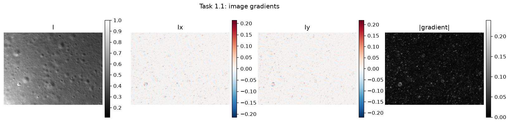
</p>

- Gradients are **strongest** on crater rims, small rocks and boulders, where a sunlit side meets
  a shadowed side within a pixel or two.
- They are **weakest** on smooth regolith between craters and across the broad, slowly varying
  brightness of the lower-left region.

**Motion constraint check** on a synthetic shift of $(0.3, -0.2)$ px:

| Mean residual $\lvert I_x u + I_y v + I_t \rvert$ | Max residual |
|---:|---:|
| **0.0042** | 0.106 |

<p align="center">
  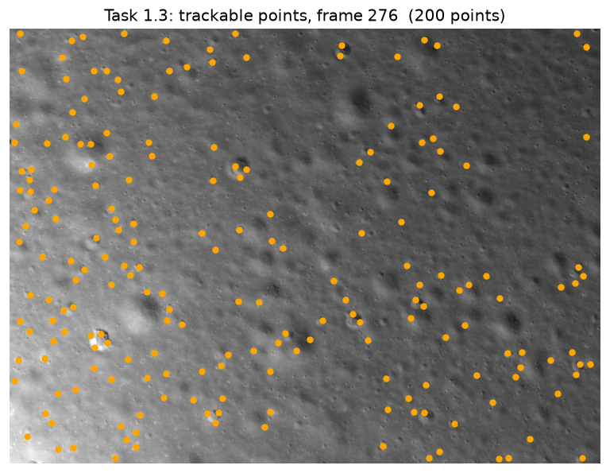
</p>

200 Shi-Tomasi points on frame 276, spread across the frame by the 10 px minimum distance and
concentrated on rocks and crater rims.

**Speed of feature selection** (one 588 x 432 frame): per-pixel loop 6.1 s, integral-image
version 0.14 s, about **45x faster**.

### 5.2 Stages 2 and 3: accuracy against motion size

Frame 300 shifted by known amounts (60 points, 15 x 15 windows), mean flow error in px:

| True shift (px) | 0.10 | 0.15 | 0.22 | 0.33 | 0.49 | 0.73 | 1.09 | 1.63 | 2.42 | 3.61 | 5.37 | 8.00 |
|---|---:|---:|---:|---:|---:|---:|---:|---:|---:|---:|---:|---:|
| One-step LK | 0.002 | 0.003 | 0.005 | 0.007 | 0.010 | 0.015 | 0.100 | 0.685 | 1.670 | 3.197 | 5.128 | 7.788 |
| Iterative LK | 0.004 | 0.005 | 0.007 | 0.010 | 0.011 | 0.009 | 0.004 | 0.010 | **0.011** | 0.681 | 3.022 | 6.644 |

<p align="center">
  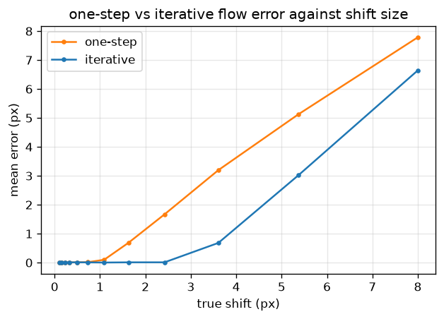
</p>

- **One-step** LK is very accurate for sub-pixel motion (about 2 % of the shift) but degrades
  quickly above **1 px**: by 2.4 px its error (1.67 px) is almost as large as the motion itself.
- **Iterative** LK stays accurate to about **2.4 px** (error 0.011 px, about 150x lower than
  one-step at the same shift) and breaks down beyond 3.6 px, because it converges to a wrong
  solution when it starts too far from the answer.

### 5.3 Stage 3: three trackers on real frame pairs

Mean displacement of valid tracks and failed-track rate (60 points per pair):

| Pair | Situation | One-step | Iterative | SIFT-guided |
|------|-----------|----------|-----------|-------------|
| 375 to 376 | hover, small motion | 1.07 px, 0.02 | 1.29 px, 0.02 | 1.29 px, 0.02 |
| 300 to 301 | mid-descent | 0.30 px, 0.08 | 2.38 px, 0.08 | **10.03 px**, 0.13 |
| 409 to 410 | near touchdown, 2 s step, about 25 % zoom | 0.30 px, 0.10 | 2.52 px, 0.13 | **32.74 px**, 0.60 |

- **375 to 376:** the motion (about 1.3 px) is inside the convergence range, so iterative and
  SIFT-guided agree exactly; one-step undershoots slightly.
- **300 to 301:** the motion is about 10 px. Started from zero, both LK variants stop at a wrong
  solution near the origin (0.30 and 2.38 px) while still reporting most tracks as valid. Only the
  SIFT-seeded tracker follows the ground. **A track marked valid can still be wrong.**
- **409 to 410:** the ground expands outward by up to 61 px. SIFT-guided tracking follows it but
  loses 60 % of points: windows near the borders leave the image, the strong scale change deforms
  each window (no longer a pure translation), and SIFT finds fewer reliable matches.

<p align="center">
  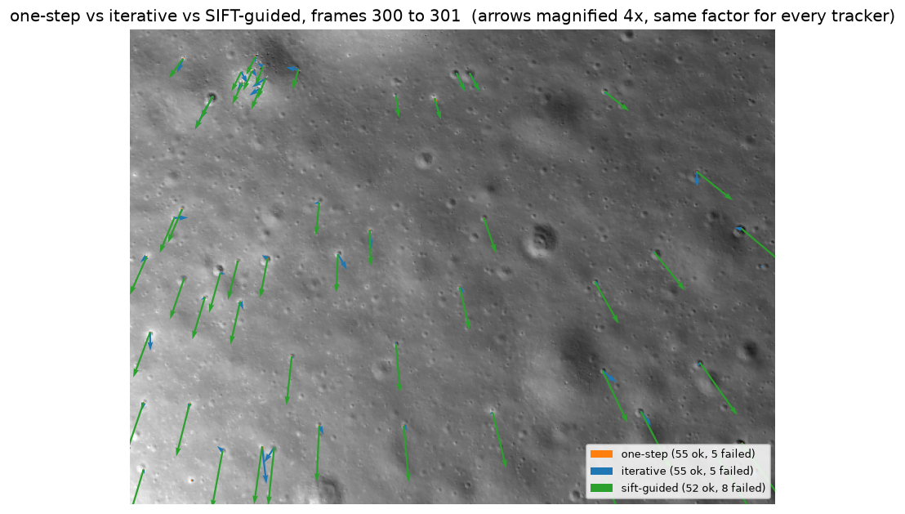
  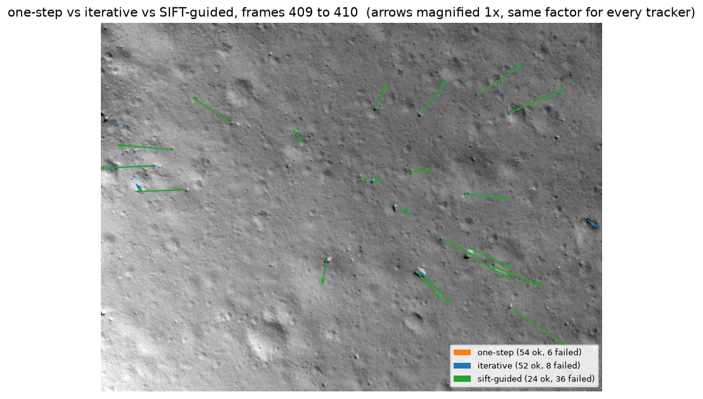
</p>

### 5.4 Stage 4: motion over the whole descent

Per-pair zoom, rotation and shift from the SIFT-guided tracks (143 pairs, 97 to 199 valid tracks each):

<p align="center">
  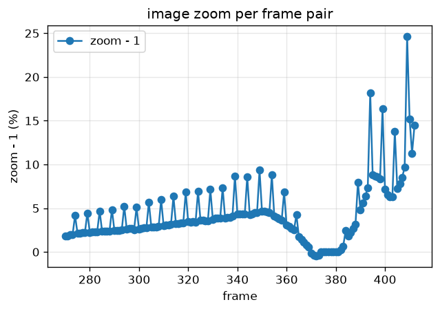
  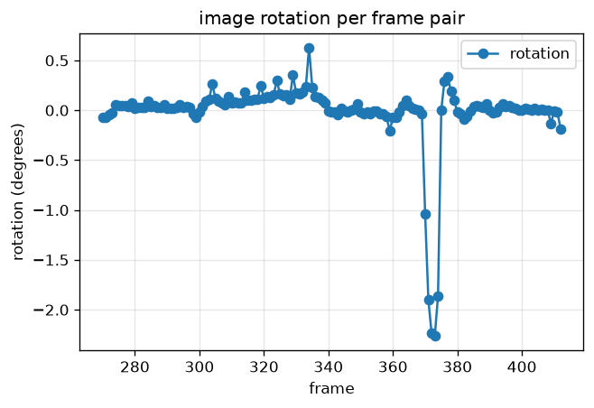
  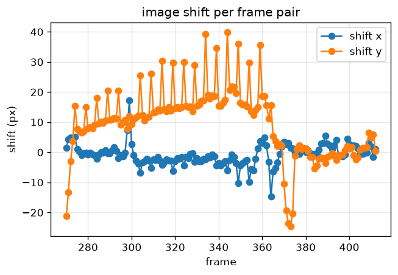
</p>

**Phases of the descent:**

| Frames | Phase | What the plots show |
|--------|-------|---------------------|
| 270 to 272 | End of pitch-over | Large transient shift ($t_y \approx -21$ px) |
| 272 to 350 | Approach | Steady descent with forward drift; zoom grows from 2 % to 4.5 % per frame, shift $y$ from 8 to 20 px |
| 350 to 368 | Braking | Zoom and shift fall toward 0 |
| 368 to 384 | Hover near 100 m | Zoom near 0; an avoidance manoeuvre around 370 to 375 with a yaw of about $-2^\circ$ per frame and a sideways shift |
| 384 to 413 | Final vertical descent | Shift near 0, zoom rising to 10 to 25 % per frame |

**A pattern not caused by the lander:** every fifth pair (274, 279, 284, ..., 409) has a zoom and
shift about **twice** its neighbours, then drops straight back. A lander cannot double its speed
for exactly one frame on a perfectly regular five-frame period: these steps span **2 s** instead
of 1 s (camera timing). `step_multiples` finds **25** such steps, so the 143 pairs cover **168 s**,
not 143 s.

### 5.5 Stage 4: the reconstructed flight

| Quantity | Value |
|----------|-------|
| Altitude, start to end | **3667 m to 9.1 m** |
| Duration | **168 s** |
| Largest descent speed | **68.4 m/s** |
| Horizontal drift | **2280 m** (mostly along $+Y$, the top of frame 270) |
| Hover altitude | about 100 m (frames 368 to 384) |

<p align="center">
  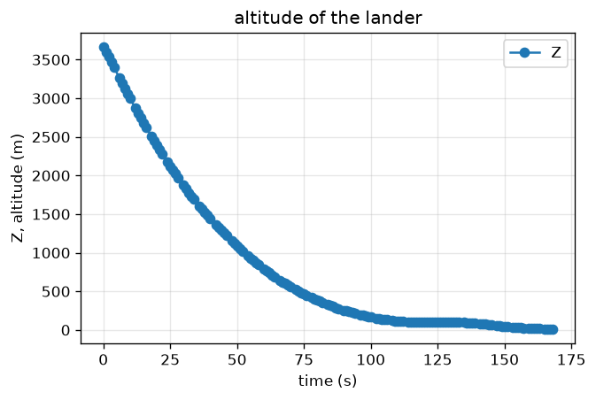
  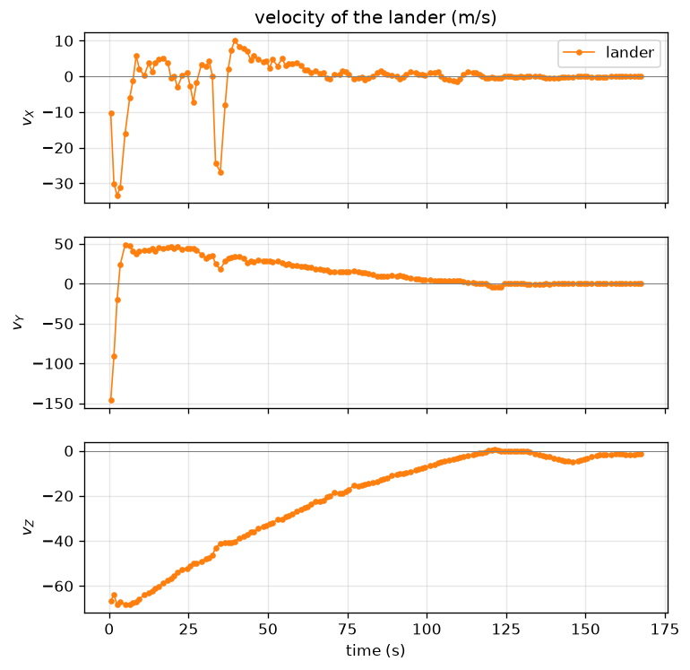
</p>

<p align="center">
  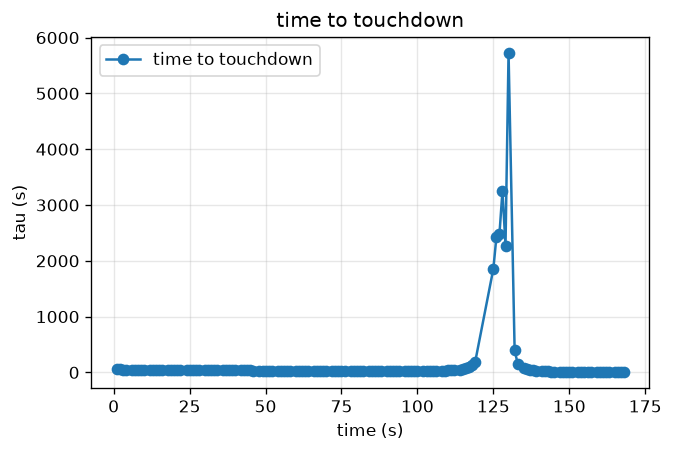
  
  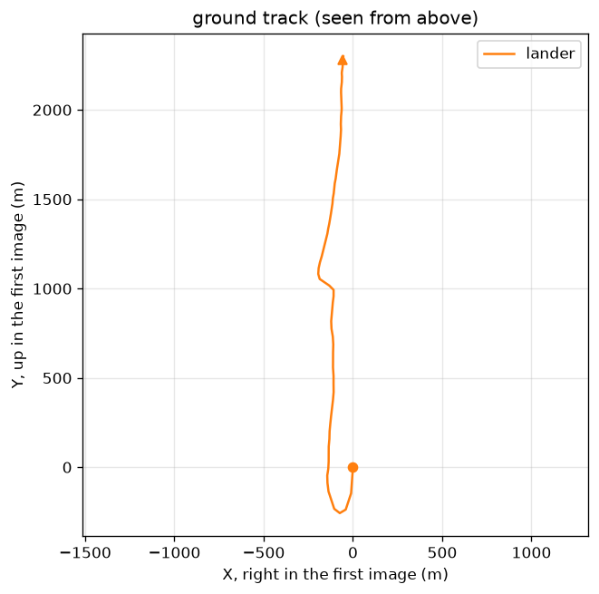
</p>

- $v_Z$ goes from about $-68$ m/s at the start, through 0 during the hover, to about $-1.3$ m/s
  just before the camera's last frame.
- The horizontal speed decays from about 45 m/s during the approach to near 0 from the hover on.
- The time to touchdown stays between roughly 21 and 55 s during the approach, becomes infinite in
  the hover, and falls to about 7 s at the last frame.

### 5.6 Stage 4: comparing the three trackers

The full pipeline run once per tracker on the same points:

| Tracker | Median tracks | End altitude | Horizontal drift | Median residual |
|---------|--------------:|-------------:|-----------------:|----------------:|
| One-step | 189 | 99.0 m | 1.3 m | **0.23 px** |
| Iterative | 187 | 92.9 m | 8.8 m | 1.78 px |
| SIFT-guided | 172 | **9.1 m** | 2280 m | 0.35 px |

<p align="center">
  
</p>

- Only the **SIFT-guided** flight reaches the ground. One-step and iterative tracking see almost
  no motion, so they conclude the lander barely moved from about 100 m. This matches Stage 3,
  where both stalled near zero on 300 to 301.
- **A low residual does not mean a correct tracker.** One-step has the lowest median residual
  (0.23 px) but the wrong flight: when every track underestimates the motion in the same way, the
  tracks still agree with each other on a near-identity similarity. The residual measures
  consistency with the model, not correctness.

### 5.7 Sensitivity

- **Errors compound along the descent.** $\log Z$ is a sum of per-step log zooms, so random zoom
  errors grow like $\sqrt{n}$ and biases grow linearly. A 0.1 % bias per step over the 111 steps
  from frame 381 back to 270 already gives about 12 % altitude error.
- **Anchor altitude 10 % too high:** every altitude, horizontal displacement and velocity becomes
  10 % too large; zooms, rotations, the shape of the path and $\tau$ do not change.
- **Focal length 10 % too high:** altitudes, $v_Z$ and $\tau$ do not change (zoom does not depend
  on $f$), but horizontal displacements scale with $Z/f$, so drift and horizontal speed become
  about 9 % too small.

---

## 6. Limitations and possible improvements

**Limitations**

- **Start altitude.** 3667 m is extrapolated through 111 chained zooms from a single anchor, so it
  is the least reliable number.
- **Flat ground and nadir camera.** At frames 270 to 272 the lander is still finishing its
  pitch-over; tilt changes are read as image shift and produce a spurious horizontal speed of
  about 145 m/s in the first step. Near touchdown, crater relief is no longer small compared with
  an altitude of about 10 m, so the zoom varies across the image.
- **Constant motion in a window.** At 10 to 25 % zoom per step a 15 x 15 window is stretched, not
  only shifted. Together with plume dust this raises the fit residual to 12 to 16 px at frames 411
  and 412, against about 0.2 px for most of the descent.
- **No ground truth.** Only one altitude reading is available to check against.

**Possible improvements**

- **Pyramidal (coarse-to-fine) KLT.** Would handle 300 to 301 (10 px becomes about 1.3 px at 1/8
  scale) without SIFT, but would not fully fix 409 to 410, where the window deformation and points
  leaving the image remain.
- **Affine or similarity Lucas-Kanade** per window, to model the local zoom near touchdown.
- **Bundle-style smoothing** of altitudes across many frames instead of chaining pairwise zooms.
- **Independent checks:** the lander's altimeter or a radio-tracking trajectory for the altitude
  profile; locating the landing site in orbital images for the horizontal drift.

---

## 7. Troubleshooting

| Problem | Cause | Fix |
|---------|-------|-----|
| `FileNotFoundError: frame directory not found: ...data/frames` (or `...lunar-velocity-mission/data/frames`) | Frames not added | Put `270.png` to `413.png` in `data/frames/` (Section 3.4) |
| `No module named pytest` / `No module named PIL` | Dependencies not installed in the active environment | `python -m pip install -r requirements.txt` (the package for `PIL` is called **Pillow**) |
| `Fatal error in launcher: Unable to create process using ...` when running `pip` | The project folder was moved after creating `.venv` | Use `python -m pip ...`, or delete `.venv` and create it again (Section 3.3) |
| Traceback shows Python from `WindowsApps` instead of `.venv` | Virtual environment not active or broken | Activate it, or delete `.venv` and create it again |
| PowerShell refuses to run `activate` | Script execution policy | `Set-ExecutionPolicy -Scope CurrentUser RemoteSigned` |
| A notebook says it cannot find functions from an earlier task | Earlier notebook not saved | Save (Ctrl+S) the earlier notebook, then rerun the setup cell |
| Task 4 is very slow | A per-pixel loop in feature selection | Use the integral-image version (Section 4.1.4) |
| You want Task 4.4 to track again instead of reusing saved tracks | Tracks are cached in `outputs/task4/compare/` while the code is unchanged | Run `python -m provided.task4.compare_trackers --retrack` |

---

## 8. Credits and references

- **Course:** ES666 Computer Vision, IIT Gandhinagar, Prof. S. Raman. The `provided/` package
  (I/O, bilinear sampling, SIFT, similarity fit, flight code, plotting and tests) is course starter
  code; the notebook implementations and analysis are my own.
- **Data:** Chang'e-5 landing camera (LCAM) level 2A images, 1 December 2020, Ground Research and
  Application System of China's Lunar and Planetary Exploration Program, https://moon.bao.ac.cn.
- **Anchor altitude:** descent trajectory reconstruction from radio tracking, *Remote Sensing* 13,
  4837 (2021).
- B. D. Lucas and T. Kanade, "An Iterative Image Registration Technique with an Application to
  Stereo Vision", IJCAI 1981.
- J. Shi and C. Tomasi, "Good Features to Track", CVPR 1994.
- D. G. Lowe, "Distinctive Image Features from Scale-Invariant Keypoints", IJCV 2004.
- J.-Y. Bouguet, "Pyramidal Implementation of the Lucas Kanade Feature Tracker", Intel
  Corporation, 2001.

**Tech stack:** Python, NumPy, Pillow, Matplotlib, Jupyter, pytest (Plotly only for the optional
animation).